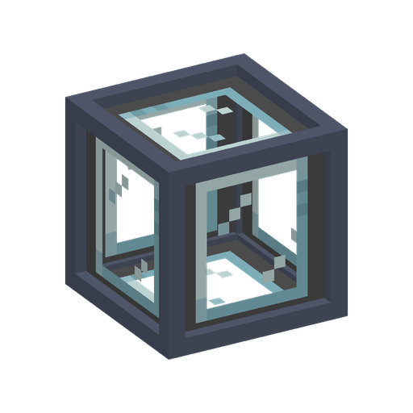

<!-- Template credit: https://github.com/othneildrew/Best-README-Template -->

<br />
<p align="center">
  <a href="https://github.com/0Lynk/Waystone-Xp-Payment">
    
  </a>

  <h3 align="center">Waystone XP Payment</h3>

  <p align="center">
    Let a tank of experience fluid pay for your waystone teleports
    <br />
    <a href="docs/"><strong>Browse the documentation »</strong></a>
    <br />
    <br />
    <a href="https://github.com/0Lynk/Waystone-Xp-Payment/releases/latest">Download</a>
    ·
    <a href="https://github.com/0Lynk/Waystone-Xp-Payment/issues/new">Report a Bug</a>
    ·
    <a href="CHANGELOG.md">Changelog</a>
    ·
    <a href="docs/verification.md">What is verified</a>
  </p>
</p>

<p align="center">
  <a href="https://github.com/0Lynk/Waystone-Xp-Payment/actions/workflows/build.yml">
    
  </a>
  <a href="https://github.com/0Lynk/Waystone-Xp-Payment/releases/latest">
    
  </a>
  
  
  <a href="LICENSE">
    
  </a>
</p>

<!-- TABLE OF CONTENTS -->
<details open="open">
  <summary>Table of Contents</summary>
  <ol>
    <li><a href="#about-the-project">About The Project</a></li>
    <li><a href="#supported-versions">Supported Versions</a></li>
    <li>
      <a href="#getting-started">Getting Started</a>
      <ul>
        <li><a href="#for-players">For Players</a></li>
        <li><a href="#for-server-owners">For Server Owners</a></li>
        <li><a href="#for-modpack-developers">For Modpack Developers</a></li>
      </ul>
    </li>
    <li><a href="#how-a-teleport-is-paid">How a Teleport Is Paid</a></li>
    <li><a href="#the-tank-screen">The Tank Screen</a></li>
    <li><a href="#commands">Commands</a></li>
    <li><a href="#compatibility">Compatibility</a></li>
    <li><a href="#building-from-source">Building From Source</a></li>
    <li><a href="#contributing">Contributing</a></li>
    <li><a href="#disclosure-of-ai-generated-content">Disclosure of AI-Generated Content</a></li>
    <li><a href="#license">License</a></li>
  </ol>
</details>

<!-- ABOUT THE PROJECT -->
## About The Project

<p align="center">
  
</p>

[Waystones](https://github.com/TwelveIterations/Waystones) charges the travelling player for every teleport. On a
server that makes XP a personal resource: everybody farms their own, an XP farm cannot pay for anybody else's travel,
and a shared hub has no way to run on the base's supply instead of everybody's pockets.

Waystone XP Payment turns that cost into a **shared, automatable resource**. A tank of experience fluid sits under the
waystone, and the teleport is paid out of the tank.

- one tank can fund a base, a teleport hub, or a whole shared network;
- any tech mod's pipes, pumps and tanks can feed it through the standard NeoForge fluid capability;
- who may draw from the pool is decided per player and per FTB team;
- what a fluid is worth comes from a datapack, so a pack can reprice a fluid without touching Java.

<!-- SUPPORTED VERSIONS -->
## Supported Versions

| Minecraft | Waystone XP Payment | Support Status |
|-----------|---------------------|----------------|
| 1.21.1    | 0.6.x               | ✅             |
| 1.20.x    | —                   | ❌             |
| other     | —                   | ❌             |

- ✅ - In support; the active version, receiving all fixes and features.
- ❌ - Not supported; no build exists for this version.

The mod targets NeoForge **21.1.x** and Waystones **21.1.45 or newer** (built and tested against 21.1.46).

<!-- GETTING STARTED -->
## Getting Started

### For Players

1. Install NeoForge 21.1.x for Minecraft 1.21.1.
2. Install [Waystones](https://modrinth.com/mod/waystones) 21.1.45 or newer; Balm comes with it.
3. Drop `waystone_xp_payment-<version>.jar` from [releases](https://github.com/0Lynk/Waystone-Xp-Payment/releases/latest)
   into your `mods` folder.

One jar serves both sides. Installing it on the client as well as the server is recommended: the tank screen, the
tooltips and the greyed-out teleport entries are client-side.

Optional: [FTB Teams](https://www.curseforge.com/minecraft/mc-mods/ftb-teams-forge) for team-based access lists.

To use it, place an **XP Payment Tank** and put the teleport source **directly on top of it** — a waystone, warp plate,
warp portal or sharestone all work. Fill the tank with an accepted payment fluid (any pipe, or a bucket in hand), then
teleport as usual.

### For Server Owners

`config/waystone_xp_payment-common.toml`:

```toml
[payment]
  skipPaymentInCreative = true

[tank]
  capacityMb = 16000               # 16 buckets, the ceiling; existing files keep what they already say
  allowBucketInteraction = true
  # let the pool under the *destination* pay while its chunk is unloaded
  remoteDestinationPayments = true
  # chunk loads one teleport may spend looking for that destination pool (0-4)
  remotePaymentChunkLoadsPerTeleport = 1
```

> **Note**
> Rates are not configured here. How much a fluid is worth is a datapack question, so that a modpack can ship its own
> numbers and a fluid added by another mod can be priced without a new release.

### For Modpack Developers

A fluid counts as experience only if a `waystone_xp_payment:xp_fluid` recipe declares it. The mod ships declarations
for the fluids it has been tested against, so ordinary setups need nothing. These are the built-in rates, each one
measured against the mod's own exchanger rather than guessed:

| Fluid | XP per bucket |
|---|---|
| `create_enchantment_industry:experience` | 200 |
| `enderio:fluid_xp_juice_still` | 10 |
| `industrialforegoing:essence` | 10 |
| `cyclic:xpjuice` | 10 |
| `openblocks_reborn:xp_juice` | 10 |
| `beyonddimensions:xp_fluid` | 10 |
| `sophisticatedcore:xp_still` | 10 |

```json
{
  "type": "waystone_xp_payment:xp_fluid",
  "fluid": "create_enchantment_industry:experience",
  "xp_per_bucket": 200
}
```

```js
// kubejs/server_scripts/waystone_xp_payment.js
ServerEvents.recipes(event => {
  event.custom({
    type: 'waystone_xp_payment:xp_fluid',
    fluid: 'create_enchantment_industry:experience',
    xp_per_bucket: 200
  })
})
```

`xp_per_bucket` is how much XP one bucket (1000 mB) of the fluid is worth, so `1000` means 1 mB = 1 XP. Declaring the
same fluid in a higher-priority pack **overrides** the earlier rate — that is how a pack reprices a fluid — and
`"xp_per_bucket": 0` removes a built-in declaration instead. Only exact fluid ids are matched; flowing variants follow
their still id, and tags are not consulted.

The full contract, including how packs override each other and what happens to a fluid that is declared nowhere, is in
[`docs/数据包契约-经验流体.md`](docs/数据包契约-经验流体.md). That page also lists the fluids in the built-in table,
and [`docs/SOP-内置默认数据包.md`](docs/SOP-内置默认数据包.md) describes how a new one gets there (confirm the exact
id, then measure how much XP one bucket really is).

<!-- HOW IT IS PAID -->
## How a Teleport Is Paid

When you click a destination, the cost is settled in this order:

1. the tank **under the source** you are leaving;
2. whatever it cannot cover is paid by a tank **under the destination**;
3. whatever both miss is paid by the **player**;
4. if even that is not enough, the teleport is cancelled and **nothing** is consumed.

Entries in the destination list are greyed out ahead of time when the tank cannot cover the trip, and the tooltip says
how much the tank covers and how much the trip needs. The server re-checks everything when you click, so a stale
reading can only cost you a refused teleport, never a wrong charge.

If the tank under the source is empty or missing, the mod looks for a tank under the destination — that is what the
`remoteDestinationPayments` and `remotePaymentChunkLoadsPerTeleport` settings are for, since the destination chunk is
usually not loaded when you are standing at the source.

<!-- THE TANK SCREEN -->
## The Tank Screen

Right-click a tank to open its screen. `+ Add yourself` adds you, `+ Add my team` adds every team you are currently in
(disabled while you are in none), and the mode button switches between whitelist and blacklist.

To add somebody else, click the filter box and type: the list turns into candidates — online players (blue) and teams
(amber). **A click only selects a row.** Acting on it means opening its menu: right-click the row, or click the `···`
in its corner, then pick *Add to list*, *Remove from list* or *View team members*. Typing only filters what the client
was given, so names never reach the server. `Esc` backs out one layer at a time.

The owner of a tank is the player who placed it; only the owner, and players sharing an FTB team with them, may edit
the list. Everybody else sees the same screen read-only.

<!-- COMMANDS -->
## Commands

Operators (permission level 2) can use these while looking at a tank, and from the console:

```
/waystonexppayment info
/waystonexppayment access mode <whitelist|blacklist>
/waystonexppayment access addplayer <name>
/waystonexppayment access removeplayer <name>
/waystonexppayment access addteam <name>
/waystonexppayment access removeteam <name>
```

The operator right is separate from ownership: it works regardless of who owns the tank.

<!-- COMPATIBILITY -->
## Compatibility

- The tank exposes the standard NeoForge `Capabilities.FluidHandler.BLOCK`, so pipes and tanks from any tech mod
  (Create, Mekanism, Thermal, …) can fill it without a per-mod integration.
- The tank holds a single fluid at a time; a fluid that is not declared as experience is rejected.
- Fluids that declare a light level light the room around the tank; fluids that do not stay unlit.
- XP **level** requirements (`ExperienceLevelRequirement` in Waystones' `warpRequirements`) are not covered by the
  tank; the player still pays those. The default Waystones configuration only uses XP points.

<!-- BUILDING -->
## Building From Source

```bash
./gradlew build        # jar in build/libs
./gradlew test         # unit tests only
./gradlew runServer    # dev server smoke test (needs an eula.txt in run/)
./gradlew runClient
```

The build is offline-friendly: `GRADLE_USER_HOME` may point at a pre-populated cache and `--offline` works.

<!-- CONTRIBUTING -->
## Contributing

Issues and pull requests are welcome, especially from modpack developers who measured a fluid's real exchange rate.

Before opening a pull request:

1. Open an issue first for anything larger than a typo, so the approach can be agreed on.
2. Run `./gradlew build`; it must pass, including the unit tests.
3. Keep the change self-contained: one branch, one pull request, one entry in `docs/变更记录/`.
4. Do not commit to `main`.

Two guards fail loudly on purpose and should not be removed: `MixinShadowPolicyTest` checks that every mixin `@Shadow`
still matches its target class, and `LangKeysTest` checks that both lang files carry the same keys with the same
arguments.

<!-- AI DISCLOSURE -->
## Disclosure of AI-Generated Content

The project uses a fixed AI-assisted development workflow with explicit quality gates.

**Roles.** The repository owner makes every design and acceptance decision. The AI coding agent (DeepSeek Harness)
writes code, documentation and commit messages. Nothing merges without the owner reviewing it first.

**Code quality constraints.** A change has to pass four gates before it can merge: compilation, unit tests (30 suites,
182 tests today, including the two guards above), an RCON smoke test on a development server, and playtesting in a real
modpack. Failing any gate rejects the merge; "merge now, fix later" is not an option here.

**Project management discipline.** Commits are atomic and use conventional prefixes, and documentation is updated in
the same change as the code it describes. Design and acceptance stay human decisions; the AI implements, and a human
reviews every change before it lands.

**Maintainability constraints.** Module boundaries stay explicit, and modules talk through events or narrow interfaces.
Configuration, data packs or KubeJS are preferred over hardcoded Java. Domain vocabulary and comments stay consistent
across the codebase. Changes to core logic ship with tests, and known technical debt is written down in
[`docs/问题修复清单.md`](docs/问题修复清单.md) instead of hidden.

<!-- LICENSE -->
## License

MIT. See [LICENSE](LICENSE).
